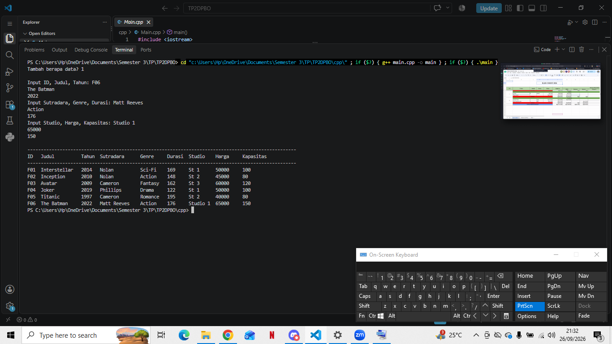
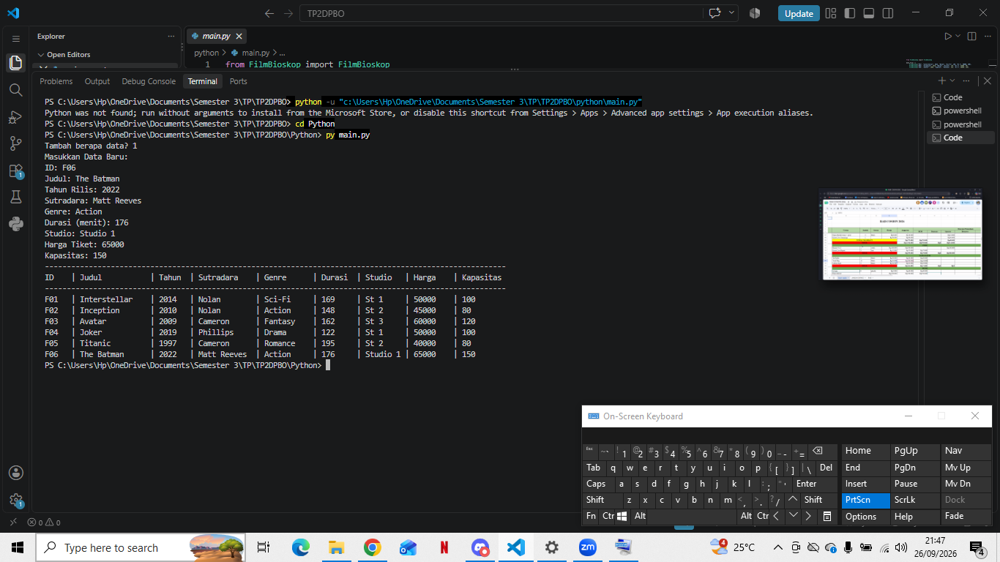
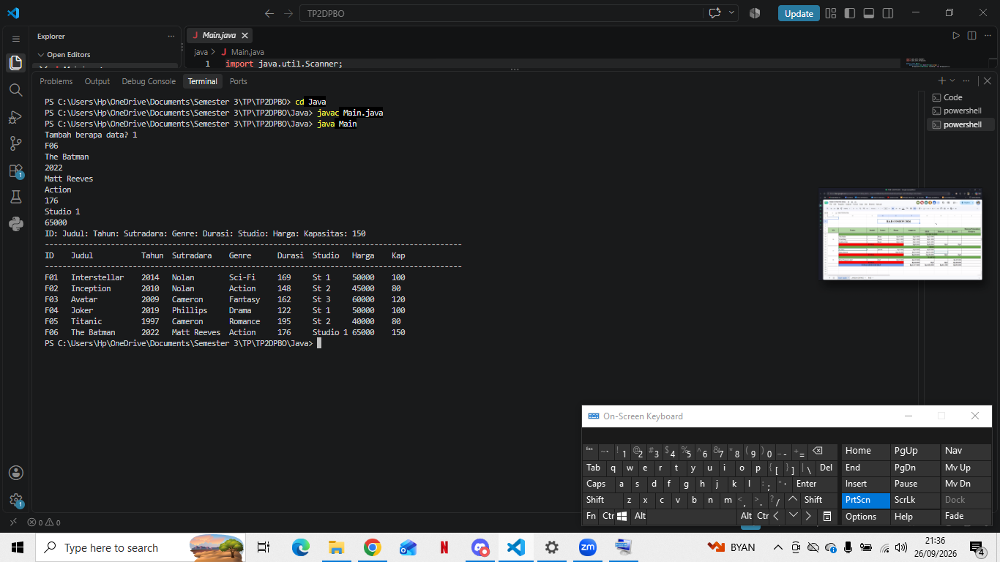
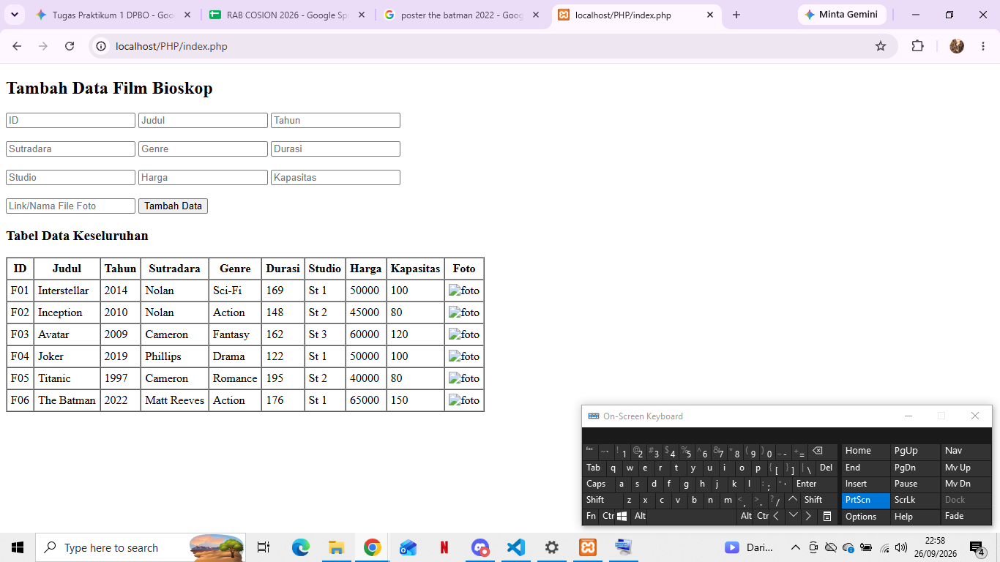

# Tugas Praktikum 2 DPBO

## Janji
Saya Najwa Angelita Rahma Haris dengan NIM 2511173 mengerjakan Tugas Praktikum 2 dalam mata kuliah Desain dan Pemrograman Berorientasi Objek untuk keberkahan-Nya maka saya tidak melakukan kecurangan seperti yang telah dispesifikasikan. Aamiin.

## Desain Program
Di tugas kali ini, programnya pakai konsep **Multilevel Inheritance** (pewarisan bertingkat) yang dibagi jadi 3 level class:
1. **Grandparent Class (`ProdukHiburan`)**: Class paling atas yang megang atribut dasar seperti `id`, `judul`, dan `tahun_rilis`.
2. **Parent Class (`Film`)**: Class turunan dari `ProdukHiburan` yang nambahin atribut khusus film yaitu `sutradara`, `genre`, dan `durasi`.
3. **Child Class (`FilmBioskop`)**: Class anak paling bungsu yang nurun dari `Film`, dengan tambahan atribut detail bioskop kayak `studio`, `harga_tiket`, dan `kapasitas`.

## Penjelasan Alur Program
1. Pas program pertama kali dijalanin, dia bakal otomatis nyiapin 5 data awal (hardcode) objek `FilmBioskop` biar tabelnya gak kosong-kosong amat.
2. Program bakal nanya ke kita, mau nambahin berapa data baru.
3. Kita tinggal ketik/input data film baru satu per satu sesuai instruksi di terminal atau lewat form web.
4. Dari inputan itu, program langsung bikin objek `FilmBioskop` baru dan nambahin datanya ke dalam list/penyimpanan yang ada.
5. Terakhir, semua data (5 data bawaan + data baru yang kita input) bakal langsung dicetak dalam bentuk tabel yang rapi jali—baik via terminal (untuk C++, Python, Java) maupun lewat tampilan web browser (untuk PHP).

## Dokumentasi Hasil Run Program

### 1. C++

### 2. Python

### 3. Java

### 4. PHP
